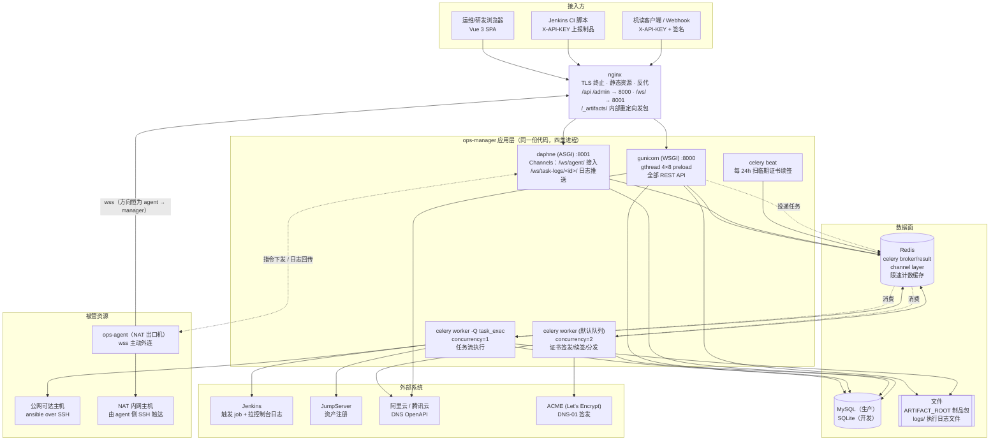
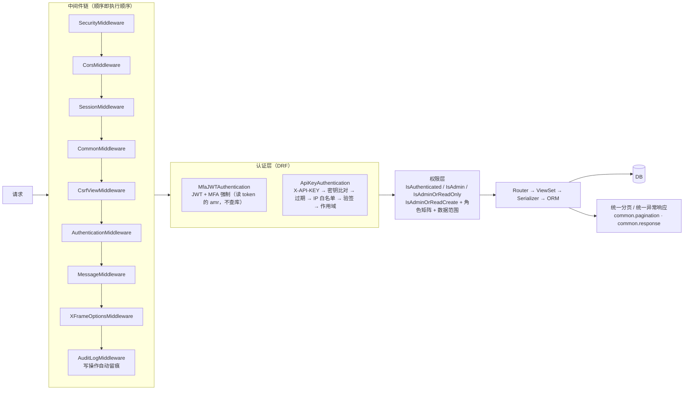
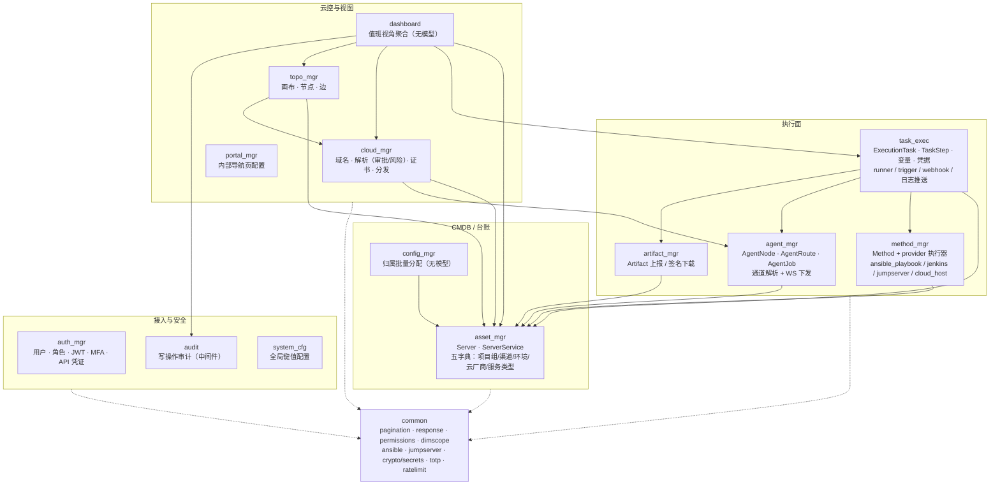
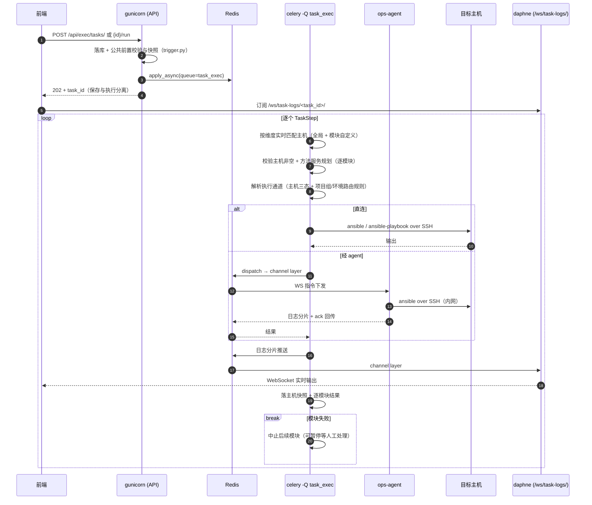
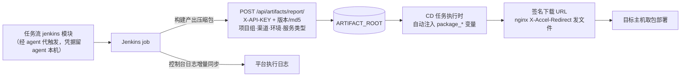
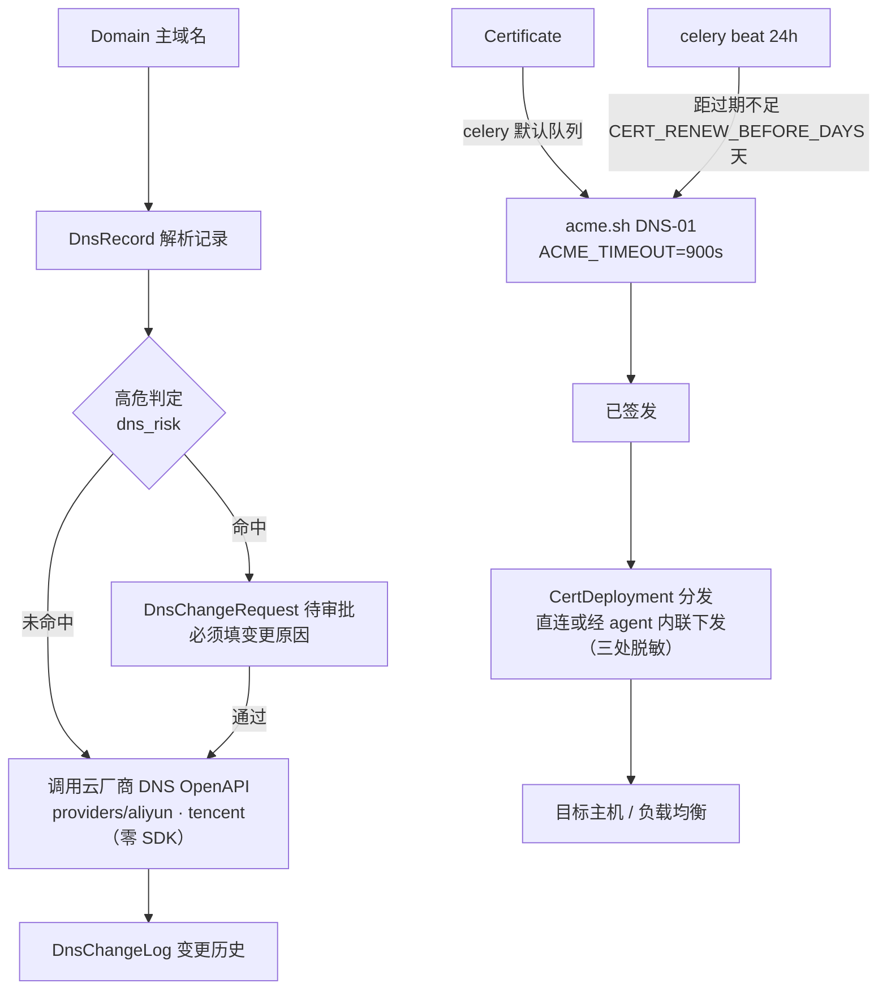
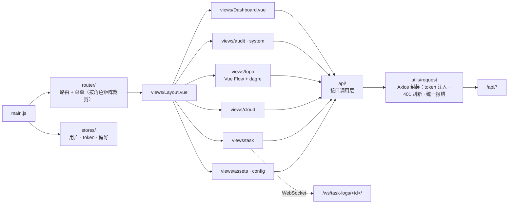

# 项目架构图

> 本文是**全局视角**的架构说明：进程怎么摆、请求怎么走、模块怎么依赖、外部系统怎么接。
> 单模块的内部设计见 [docs/backend/modules/](backend/modules/)，ops-agent 协议细节见
> [ops-agent-design.md](ops-agent-design.md)。

---

## 1. 系统全景

要点：

- **入口只有 nginx 一个**：HTTP 走 gunicorn，`/ws/` 单独分流到 daphne；两者是不同进程、不同端口，缺一个就少一半能力（缺 daphne 时前端退回轮询日志）。
- **写请求不在 web 进程里干活**：web 只落库 + 置状态 + 投 Redis，真正的 ansible/acme 在 celery worker 里跑。worker 没起 = 任务永远排队且页面无报错。
- **两个 celery worker 不共队列**：`task_exec` 队列跑任务执行，默认队列跑证书，互不抢占；同机运行必须给不同 `-n` node 名。
- **连接方向恒为 agent → manager**，manager 从不主动连 agent，NAT 内网主机零改造。

---

## 2. 进程与端口

| 进程 | 启动方式 | 端口 | 职责 | 不部署的后果 |
|------|----------|------|------|--------------|
| nginx | 系统服务 / docker | 80, 443 | TLS、静态资源、反代、`X-Accel-Redirect` 发制品 | 无入口 |
| gunicorn | `deploy/ops-manager.conf` | 127.0.0.1:8000 | 全部 REST API、Django Admin | API 全挂 |
| daphne | `deploy/ops-manager-ws.conf` | 127.0.0.1:8001 | `/ws/agent/`、`/ws/task-logs/<id>/` | agent 掉线；日志退回轮询 |
| celery worker (exec) | `deploy/ops-manager-celery-exec.conf` | — | `-Q task_exec`，跑任务流 | 任务卡在 pending |
| celery worker (默认) | `deploy/ops-manager-celery.conf` | — | 证书签发/续签/分发 | 证书永远「申请中」 |
| celery beat | `deploy/ops-manager-celery-beat.conf` | — | 24h 扫临期证书 | 不自动续签（可手动） |
| Redis | 系统服务 | 6379 | broker / result / channel layer / 缓存 | celery 与 WebSocket 均不可用 |
| MySQL | 系统服务 | 3306 | 主数据 | 全挂 |

> 生产用 **supervisor** 托管（非 systemd），配置见 `deploy/*.conf`。

---

## 3. 请求生命周期

两条关键口径：

- **MFA 强制放在认证类**而不是权限类：大量 ViewSet 自带 `permission_classes`，全局默认权限对它们不生效，放权限层会漏掉一半接口。
- **机读接口自带 `ApiKeyAuthentication`**，因而天然绕过 MFA —— 这正是期望行为（脚本无法过第二因子）。

---

## 4. 后端模块依赖

依赖只朝一个方向流：**台账 ← 执行面 ← 聚合视图**。`dashboard` / `topo_mgr` 只读别人的表，不建自己的台账；`config_mgr` / `dashboard` 无模型。

---

## 5. 任务执行链路

一个「任务」= 一条**任务流**：多个 TaskStep 模块顺序执行，任一模块失败即中止。

- **保存与执行分离**：编排时不锁主机，执行时才按维度实时匹配。
- **通道解析统一口径**（`apps/agent_mgr/channel.py`）：runner 分组、方法模块拦截、证书分发、服务器列表展示共用同一函数。
- **Jenkins 类模块**无目标主机，走 `resolve_service_agent` 四级解析（模块参数 → 方法配置 → `jenkins.agent` 系统配置 → 项目组/环境规则）。
- 日志双写：WebSocket 实时推 + 落 `logs/` 文件，断连后可回看。

---

## 6. CI/CD 与制品链路

取包按**服务类型严格匹配、不回退**：Jenkins 上报缺 `service_type` 参数会导致 CD 取不到包，而不是错发上一个类型的包。

---

## 7. 云控链路（域名 / 证书）

`issuing` 状态卡死靠**读时超时判定**自愈（worker 被砍时状态不会永远停在申请中）。

---

## 8. 数据域概览

| 域 | 主要模型 | 说明 |
|----|----------|------|
| 身份 | `Role` `User` `UserMFA` `MFARecoveryCode` `ApiCredential` | 角色矩阵 + 生产执行能力位 + 数据范围；MFA 密钥 Fernet 加密；API 凭证带 per-key IP 白名单/作用域/签名 |
| CMDB | `ProjectGroup` `Channel` `Environment` `CloudProvider` `ServiceType` `Server` `ServerService` | 五字典 + 服务器 + 进程规划（服务类型三态） |
| 执行 | `Method` `ExecutionTask` `TaskStep` `TaskExecutionLog` `Credential` `ExecVariable` `ExecVariableVersion` | 任务流 + 变量版本 + 凭据（密钥不回显） |
| 通道 | `AgentNode` `AgentRoute` `AgentJob` | 主机三态 + 路由规则 + 下发作业 |
| 制品 | `Artifact` | 版本/md5/维度四元组 + 服务类型 |
| 云控 | `CloudAccount` `Domain` `DnsRecord` `DnsChangeLog` `DnsChangeRequest` `Certificate` `CertDeployment` | 域名 / 解析 / 审批 / 证书 / 分发 |
| 视图 | `TopoCanvas` `TopoNode` `TopoEdge` | 引用型节点实时读原表，外部型手录 |
| 其它 | `SystemConfig` `PortalSetting` 等 | 全局配置、内部导航页 |

字段级说明见 [backend/models.md](backend/models.md)。

---

## 9. 前端结构

详见 [frontend/overview.md](frontend/overview.md)。

---

## 相关文档

- [后端架构总览](backend/overview.md) · [前端架构总览](frontend/overview.md)
- [API 接口文档](backend/api-reference.md) · [数据模型](backend/models.md) · [配置说明](backend/configuration.md)
- [ops-agent 设计](ops-agent-design.md) · [部署说明](../deploy/README.md)
